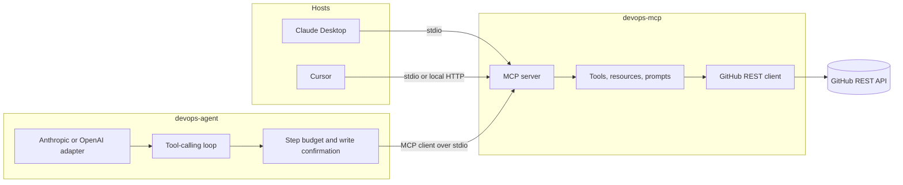

# mcp-devops-agent

A [Model Context Protocol](https://modelcontextprotocol.io) server that gives an AI assistant a small, typed set of GitHub tools, and a command-line agent that calls those tools in a loop.

This is a portfolio project by [Humberto Vieira](https://github.com/hjsvieira98), a senior React and TypeScript developer moving into AI engineering. The interesting part is not a chat wrapper. It is the boundary between a model and a side effect: schema-validated tools, a protocol a host can launch, a step budget, and a confirmation gate in front of writes. The same server runs inside Claude Desktop, Cursor, or the CLI agent. The agent never imports the GitHub client. It only speaks MCP.

Nothing here is deployed, and the repository does not claim usage numbers. Tests and evals run against an in-memory GitHub and a scripted model, so they do not need API keys.

## What it does

Ask a host, or the CLI, things like:

- Give me a morning standup summary of my repos.
- Which open pull requests have a failing check?
- Summarize pull request 17 in `acme/web`.
- Open an issue on `acme/web` titled "Investigate checkout CI".

Reads run immediately. Creating an issue is a write: the CLI asks before it calls GitHub, and it refuses the write in a non-interactive shell unless you pass `--yes`. Claude Desktop and Cursor have their own approval UI. The server marks `create_issue` with `readOnlyHint: false` so a host can tell the difference.

## Architecture



The CLI reads `devops://watchlist` before the first model turn and puts those repositories in the system prompt. Hosts that already surface MCP resources can read the same URI themselves. Prompts are templates the host fills in. They are not tools, and the model does not have to call them.

`summarize_pull_request` does not call a language model. It returns a bounded digest of the pull request and the diff. The host model writes the prose. That keeps the tool deterministic, testable, and free of a second hidden prompt.

## Tools, resources, and prompts

| Name                           | Kind              | Effect                                                                                                                              |
| ------------------------------ | ----------------- | ----------------------------------------------------------------------------------------------------------------------------------- |
| `list_open_pull_requests`      | Tool, read        | Open pull requests plus a CI rollup. Failure wins over pending, which wins over success. No checks at all is `unknown`, not a pass. |
| `summarize_pull_request`       | Tool, read        | Title, author, branches, truncated description, and truncated patches.                                                              |
| `list_issues`                  | Tool, read        | Issues only. GitHub's issues API also returns pull requests; those are filtered out of the first page.                              |
| `get_repo_activity`            | Tool, read        | Commits, updated issues, and updated pull requests. Defaults to the last 24 hours.                                                  |
| `create_issue`                 | Tool, write       | Opens an issue. Not idempotent: calling it twice creates two issues.                                                                |
| `devops://watchlist`           | Resource          | JSON list of `owner` / `repo` pairs from `GITHUB_REPOS`.                                                                            |
| `github://repo/{owner}/{repo}` | Resource template | Description, default branch, visibility, and open-issue count. Watched repos are also listed.                                       |
| `morning_standup`              | Prompt            | Tells the model to read the watchlist, then activity and open pull requests, and to write a standup from those results only.        |
| `pr_review_brief`              | Prompt            | Tells the model to brief one pull request from `summarize_pull_request`.                                                            |

Every tool argument is a Zod schema. The MCP SDK turns that schema into the JSON Schema the model sees and rejects a bad call before the handler runs. GitHub responses are parsed with Zod as well, so a shape the client does not understand becomes an error instead of a silent `undefined`. Tool failures are returned as `isError: true` with a message the model can read. The token is never accepted as an argument, and it is stripped from error text if an upstream body echoes it.

Lists are the first page only, with a cap of 30. Diff text defaults to 8,000 characters and cannot exceed 20,000. That is a context-window limit, not a claim that the digest is a full review.

## Requirements

- Node.js 20 or newer. CI uses Node 22.
- A GitHub personal access token only when you call the real API. Classic tokens need `repo` for private repositories. Fine-grained tokens need read access to metadata, pull requests, issues, and commit statuses. Check-run details also need permission to read checks. If that permission is missing, the pull-request tool keeps the combined commit status and says so.
- `ANTHROPIC_API_KEY` or `OPENAI_API_KEY` only for the CLI agent. Claude Desktop and Cursor use their own model.

This project does not load a `.env` file. [`.env.example`](.env.example) is a checklist. Export the variables in your shell, or put them in the host's MCP config. The host config is the better place for the token, because the server process receives it and the chat does not.

## Setup from a fresh clone

```bash
git clone https://github.com/hjsvieira98/mcp-devops-agent.git
cd mcp-devops-agent
npm install
npm test
npm run eval
npm run lint
npm run build
```

`npm test` and `npm run eval` do not call GitHub or a model provider.

Run the server over stdio. It waits for a host. Logs go to stderr, because stdout is the JSON-RPC stream.

```bash
export GITHUB_TOKEN="github_pat_..."
export GITHUB_REPOS="owner/repo,owner/other"
node dist/index.js
```

During development you can skip the build:

```bash
npm run dev
```

Optional local HTTP, bound to `127.0.0.1` only. The SDK's localhost Host and Origin checks sit in front of the handler. `GET /health` is a plain liveness check. The MCP endpoint is `POST /mcp`.

```bash
npm run dev:http
# devops-mcp listening on http://127.0.0.1:3333/mcp
```

`MCP_HTTP_PORT` changes the port. Prefer stdio for a desktop host. Use HTTP when a client attaches to a URL you already started. Do not expose this process beyond your machine: it holds your GitHub token and it does not authenticate callers.

The MCP Inspector can list and call the tools without a chat host:

```bash
npx @modelcontextprotocol/inspector node dist/index.js
```

Set `GITHUB_TOKEN` and `GITHUB_REPOS` in that shell first.

## Claude Desktop

Claude Desktop launches the server as a child process. Merge this into the config file:

- macOS: `~/Library/Application Support/Claude/claude_desktop_config.json`
- Linux: `~/.config/Claude/claude_desktop_config.json`
- Windows: `%APPDATA%\Claude\claude_desktop_config.json`

Use the absolute path to `dist/index.js` from the clone. Restart Claude Desktop after saving.

```json
{
  "mcpServers": {
    "devops-mcp": {
      "command": "node",
      "args": ["/ABSOLUTE/PATH/mcp-devops-agent/dist/index.js"],
      "env": {
        "GITHUB_TOKEN": "github_pat_...",
        "GITHUB_REPOS": "owner/repo,owner/other"
      }
    }
  }
}
```

In the chat, you can ask for a standup or attach the `morning_standup` prompt if the client lists prompts. The server instructions tell the model that `create_issue` writes to GitHub and that it should not ask you to paste a token.

## Cursor

Project config (`.cursor/mcp.json`) or user config (`~/.cursor/mcp.json`):

```json
{
  "mcpServers": {
    "devops-mcp": {
      "command": "node",
      "args": ["/ABSOLUTE/PATH/mcp-devops-agent/dist/index.js"],
      "env": {
        "GITHUB_TOKEN": "github_pat_...",
        "GITHUB_REPOS": "owner/repo,owner/other"
      }
    }
  }
}
```

If the server is already running with `--http`, Cursor can attach by URL instead of launching a process:

```json
{
  "mcpServers": {
    "devops-mcp": {
      "url": "http://127.0.0.1:3333/mcp"
    }
  }
}
```

The token still lives in the server process, not in Cursor's chat.

## CLI agent

The agent is a separate program. It spawns the MCP server, lists tools, and runs a loop: ask the model, call the tools it requested, append the results, repeat. When the model stops requesting tools, that text is the answer.

```bash
export GITHUB_TOKEN="github_pat_..."
export GITHUB_REPOS="owner/repo,owner/other"
export ANTHROPIC_API_KEY="sk-ant-..."
# optional: LLM_PROVIDER=openai and OPENAI_API_KEY instead
# optional: LLM_MODEL=claude-sonnet-5-5 or gpt-5.4
npm run agent -- "Give me a morning standup summary of my repos"
```

`LLM_PROVIDER` is optional when only one key is set. The default models are `claude-sonnet-5-5` and `gpt-5.4`. Override them with `LLM_MODEL` when you want a different snapshot. The adapters talk to the providers over HTTP. They do not depend on the provider SDKs, and they do not send sampling parameters such as `temperature`.

Model keys are not copied into the server's environment. The child receives `PATH` and the GitHub variables only.

```bash
npm run agent -- --max-steps 4 "Which pull requests are failing CI?"
npm run agent -- --yes "Open an issue on owner/repo titled \"Investigate flaky login\""
```

`--max-steps` is the number of tool executions allowed, from 1 to 30, default 8. A declined write counts, so a model cannot spend the budget retrying a confirmation you refused. After the budget is spent, the model gets one more turn with the tools removed and has to answer from what it already collected.

Without `--yes`, a terminal prompts on stderr:

```text
About to call create_issue with {
  "owner": "owner",
  "repo": "repo",
  "title": "Investigate flaky login"
}
Proceed? [y/N]
```

A pipe or CI job is not a terminal. The write is denied unless `--yes` is present. Progress is printed to stderr. The final answer is printed to stdout.

After `npm run build`, the same CLI is `node dist/agent/cli.js`. `npm run agent` uses `tsx` and spawns `src/index.ts`, so the build is optional for local runs and required for the host config above.

### Example session

This transcript uses the fixture repositories from the eval suite (`acme/web` and `acme/api`). It shows the CLI's real progress format. The standup paragraph is an illustration of the answer the system prompt asks for, written from those fixture facts. It is not a recording of a live model, and it is not a log from a real GitHub account.

```text
$ npm run agent -- "Give me a morning standup summary of my repos."
devops-agent  provider=anthropic model=claude-sonnet-5-5  maxSteps=8
watched: acme/web, acme/api
→ get_repo_activity {"owner":"acme","repo":"web"}
← get_repo_activity ok
→ list_open_pull_requests {"owner":"acme","repo":"web"}
← list_open_pull_requests ok
→ get_repo_activity {"owner":"acme","repo":"api"}
← get_repo_activity ok
→ list_open_pull_requests {"owner":"acme","repo":"api"}
← list_open_pull_requests ok

Since yesterday on acme/web, ada committed "Add health check".
Pull request #17, "Reduce checkout latency", is open and its CI rollup is failure
(the build status and the unit check both failed).
acme/api has no commits in the window. Pull request #8, "Document auth", is open
and its build status is success.
Next: look at the failing build on #17 before reviewing the checkout change.
```

A matching eval, `morning-standup`, drives the real server and the real loop with a scripted model. It asserts those four tool calls, asserts `create_issue` was not executed, and asserts the final text contains facts that were present only in the tool results (`Reduce checkout latency`, `failure`, `Document auth`, `Add health check`). That checks the wiring. It does not score a live model.

## Tests and evals

```bash
npm test          # Vitest. GitHub fetch and both model APIs are mocked.
npm run eval      # Prints PASS/FAIL for each agent scenario.
npm run typecheck
npm run lint
npm run format:check
```

GitHub Actions runs lint, format, typecheck, tests, evals, and the production build on pull requests.

The eval scenarios live in [`src/evals/scenarios.ts`](src/evals/scenarios.ts):

| Scenario                 | What it locks in                                                                              |
| ------------------------ | --------------------------------------------------------------------------------------------- |
| `morning-standup`        | Activity and open pull requests for each watched repo, and no writes.                         |
| `pr-digest`              | `summarize_pull_request` for a named pull request, and the filename comes back from the tool. |
| `create-issue-declined`  | Confirmation denied. The GitHub client never sees `createIssue`.                              |
| `create-issue-confirmed` | Confirmation allowed. The created issue number is `#101` from the fixture.                    |
| `step-budget`            | `maxSteps: 2` stops a model that would keep calling `list_issues`.                            |

The scripted model is a replay, not a judge. Its final sentence is built from the tool text it was given, so a broken loop that drops tool results fails the scenario. Replacing that replay with a live model, or adding a model-graded rubric, is future work and would need keys.

## Design decisions

**One server, three hosts.** Tools are registered in `createDevOpsServer`. Stdio (`serveStdio`) and Streamable HTTP (`createMcpHandler`) are thin entries around that factory. The official MCP TypeScript SDK v2 (`@modelcontextprotocol/server` and `@modelcontextprotocol/client`) implements the 2026-07-28 revision and, by default, still serves 2025-era clients. Desktop hosts that spawn a local process speak stdio, so that is the path the config samples use.

**The agent is an MCP client.** It cannot call `GitHubRestClient` directly. A change to a tool is visible to Claude Desktop, Cursor, and the CLI together. The cost is an extra process and a JSON-RPC hop, which is the point of the protocol.

**Validation on the way in and on the way out.** Zod schemas on tool inputs stop a bad `owner` before any HTTP call. Zod schemas on GitHub JSON stop a partial payload from becoming a pull request with a missing SHA. The handler then returns `structuredContent` that the SDK checks against the tool's `outputSchema`.

**CI is two GitHub APIs.** Commit statuses and check runs are different systems. The rollup merges them and prefers failure over pending over success. A cancelled, timed-out, or action-required check counts as failure. A skipped or neutral check does not. If the token cannot read check runs, the tool reports the denial and still returns statuses, instead of failing the whole call.

**Writes are gated in the client, not by blocking on stdin inside the server.** The server's stdin is the protocol stream. A confirmation prompt there would corrupt JSON-RPC. The CLI asks the user. Hosts do the equivalent with their own permission UI, using `readOnlyHint`. A tool with no hint is treated as a write. The safe default is to ask.

**Bounded pages and patches.** The first page is a product decision. Following every `Link` header would make a standup call unbounded on a busy repository. The digest says when a patch or a file list was cut short, and the prompts tell the model to pass that on.

**Credentials stay in the process that needs them.** `GITHUB_TOKEN` is read by the server. The agent drops `ANTHROPIC_API_KEY` and `OPENAI_API_KEY` from the child environment. Tool arguments have no token field, so the model is not asked to repeat one.

**Evals that can fail in CI.** A scenario file that nobody runs does not constrain the loop. `npm run eval` executes the scenarios in-process over `InMemoryTransport`, with `MemoryGitHub` behind the same tool handlers the stdio server uses.

## Project layout

```text
src/index.ts            stdio by default, --http for Streamable HTTP
src/server/             tool, resource, and prompt registration
src/github/             REST client, errors, and the in-memory client used by tests
src/agent/              loop, guardrails, provider adapters, CLI
src/evals/              scenarios and the runner behind npm run eval
tests/                  Vitest
```

## Roadmap

These are not started. They are the next pieces this design leaves room for.

- GitHub App installation tokens instead of a personal access token, with the installation id in the server environment.
- A cursor argument so a caller can request the next page of pull requests or issues, still with a hard cap.
- Reviewers, review state, and a bounded slice of workflow logs for a failed check.
- MCP OAuth on the HTTP entry, so a shared server does not rely on a token in the environment. The local stdio path would stay as it is.
- Live-model evals with a frozen fixture set, kept separate from the deterministic tool-call checks above.

## License

[MIT](LICENSE) © 2026 Humberto Vieira
